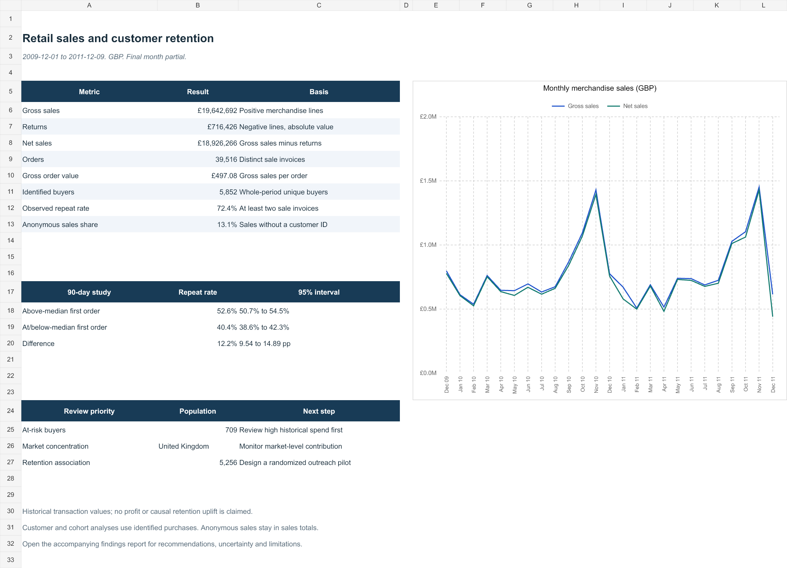

# Retail Sales and Customer Retention Analytics

An end-to-end Python, SQL and Excel portfolio project using 1,067,371 historical retail transaction records. It examines sales performance, customer segments, observed retention and whether first-order value is associated with repeat purchasing.



## Results at a glance

| Measure | Result |
|---|---:|
| Source records | 1,067,371 |
| Retained merchandise lines | 1,021,128 |
| Net merchandise sales | GBP 18,926,266.18 |
| Identified buyers | 5,852 |
| Eligible buyers in the 90-day study | 5,256 |
| Difference in 90-day repeat rates, above vs at/below median first order | 12.21 percentage points |

The data covers December 2009 to December 2011; the final month is partial. The study is observational and does not establish causal uplift. Net merchandise value is not profit or audited accounting revenue.

## Explore the completed analysis

- [Findings and recommendations](reports/FINDINGS.md)
- [Offline interactive dashboard](index.html): download/open this HTML file in a browser; GitHub's repository view displays its source rather than hosting it as a live app.
- [Excel workbook](Retail_Analytics.xlsx): summary, formulas, native charts and cohort heatmap.
- [Methodology](docs/METHODOLOGY.md) and [data dictionary](docs/DATA_DICTIONARY.md).
- [Validation and limitations](reports/VALIDATION.md).
- [Power BI build materials](powerbi/BUILD_GUIDE.md): import query, DAX and layout guide. A native `.pbix` is not included.
- [Portfolio and interview notes](reports/PORTFOLIO_NOTES.md).

The dashboard and published analysis are already populated and work without running Python.

## Quick start

Use **Python 3.12**. SQLite comes with Python; no database server or credentials are required. Run commands from this project's root folder.

Windows PowerShell, without changing your script execution policy:

```powershell
python -m venv .venv
.venv\Scripts\python.exe -m pip install -r requirements-lock.txt
.venv\Scripts\python.exe scripts/run_tests.py --unit
.venv\Scripts\python.exe src/pipeline.py --download
.venv\Scripts\python.exe scripts/run_tests.py --full
```

macOS / Linux:

```bash
python3 -m venv .venv
.venv/bin/python -m pip install -r requirements-lock.txt
.venv/bin/python scripts/run_tests.py --unit
.venv/bin/python src/pipeline.py --download
.venv/bin/python scripts/run_tests.py --full
```

`--download` retrieves the public workbook only if it is missing. The download is approximately 44 MB; processing both worksheets and regenerating the database can take several minutes. The first download needs internet access. Subsequent runs can use the saved workbook offline.

`requirements.txt` pins direct dependencies; `requirements-lock.txt` records the complete dependency set used for the clean-install check. The raw workbook, generated database and compressed line-level ledger are excluded from Git. They are regenerated by the pipeline. Small aggregate exports, the populated dashboard and the Excel snapshot remain in the repository.

The pipeline refreshes the CSV/SQLite results, HTML dashboard and findings. The Excel workbook is a separate historical snapshot; see [Excel refresh instructions](docs/EXCEL_REFRESH.md). Power BI's line-level import requires the regenerated ledger.

## Tests and automation

```bash
python scripts/run_tests.py --unit
python src/pipeline.py --download
python scripts/run_tests.py --full
python scripts/check_project.py
```

Unit checks use small in-memory fixtures and require no dataset. Full checks require the generated database and fail if it is missing, so a clean checkout cannot silently skip integration validation.

The GitHub Actions workflow runs offline unit checks on Windows and Linux for pushes and pull requests. Pushes to `main`, and manual workflow runs, also download the source, rebuild the full analysis and run all checks. Integration runs depend on UCI availability. Workflow configuration is included; the first hosted run occurs after publishing the repository.

## Project structure

```text
.github/workflows/ci.yml  GitHub Actions unit and integration checks
src/                     Cleaning, analytics and dashboard generation
sql/                     Executed SQL builds and six exploratory queries
tests/                   Cleaning, statistics and real-output tests
scripts/                 Explicit test runner and repository checks
data/processed/          Published exports; large files regenerated locally
data/raw/                Source workbook downloaded locally, ignored by Git
docs/                    Methodology, dictionary, refresh and GitHub guide
powerbi/                 Power Query, DAX, theme and build instructions
reports/                 Findings, validation and Excel preview
index.html               Populated, offline interactive analysis
Retail_Analytics.xlsx    Excel summary snapshot
```

## Analytical decisions

- Retain returns on their recorded date and report gross, returns and net separately.
- Include anonymous purchases in sales totals; exclude them from customer-level analyses.
- Preserve original source lineage and document duplicate/non-merchandise filtering assumptions.
- Calculate money in integer pennies after decimal line-value rounding.
- Use distinct invoices for order frequency, RFM scores with shared scores for ties, and first-observed-purchase cohorts.
- Preserve unobservable cohort cells as blanks and exclude the partial final month.
- Give the statistical study equal 90-day follow-up and report effect sizes, confidence intervals and limitations.

## Publish on GitHub

See [GitHub publishing guide](docs/GITHUB.md). Push the extracted project files, rather than committing a project ZIP or the generated database. No GitHub account details, remote repository or authentication tokens are embedded.

## Attribution and license

Dataset: Chen, D. (2012). *Online Retail II*. UCI Machine Learning Repository. [DOI: 10.24432/C5CG6D](https://doi.org/10.24432/C5CG6D). [Source dataset](https://archive.ics.uci.edu/dataset/502/online+retail+ii), licensed **CC BY 4.0**. This project cleans, filters and aggregates that data. See [data attribution](DATA_LICENSE.md).

Project code is provided under the [MIT license](LICENSE). The dataset's license applies separately to the data and derived exports. No sales or retention improvement is claimed.
